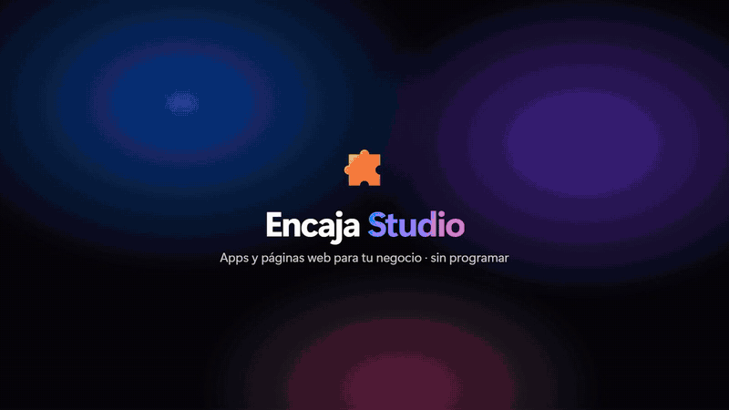
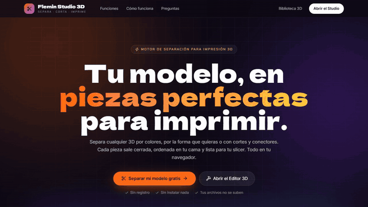
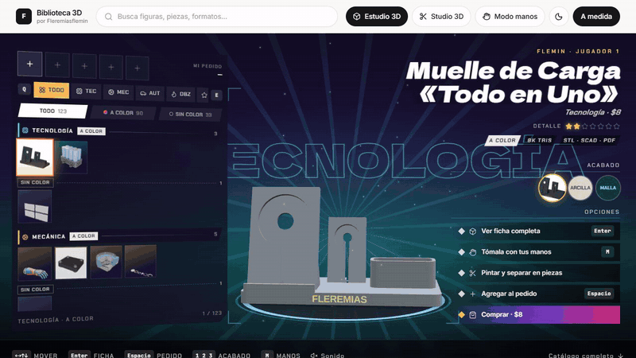
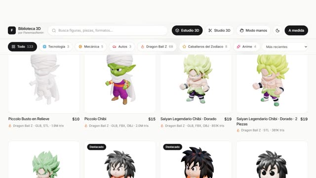
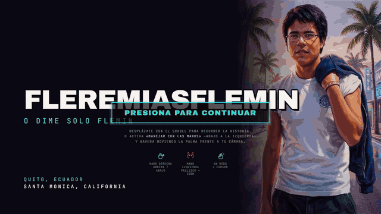
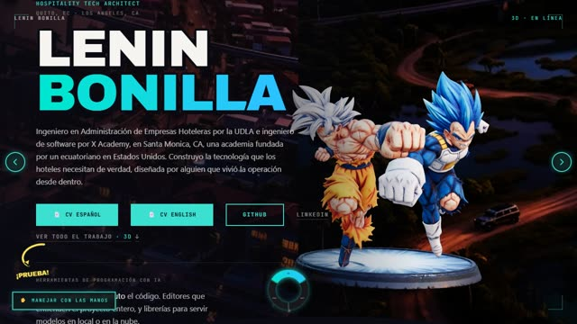
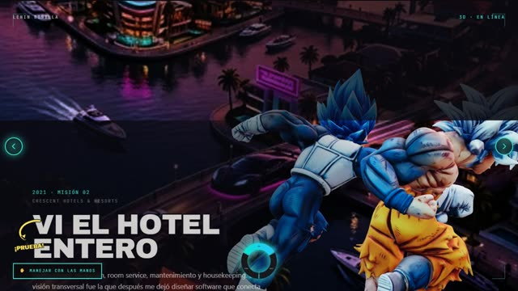

 

🎓 **Ingeniero en Software**&nbsp;&nbsp;·&nbsp;&nbsp;🏨 **Ingeniero en Administración de Empresas Hoteleras y Turísticas**

 

## 🆕 Lo nuevo

Cuatro productos lanzados este mes. Los GIF son grabaciones reales de cada sitio en vivo — toca cualquiera para abrirlo.

<!-- ───────────── ENCAJA STUDIO ───────────── -->

### 🧩 Encaja Studio — arma apps para celular como un rompecabezas

Constructor de apps móviles **sin programar**: arrastras piezas al teléfono y encajan solas. Un asistente arma la app de tu negocio en 2 minutos con tu logo, colores y WhatsApp, y la exportas como **código real**.

`Tablero infinito` · `IA que diseña pantallas` · `33 apps base` · `21 estilos` · `+80 piezas` · `HTML / React Native / Flutter`

  
  
  
 
<b>Tablero infinito</b> con flujos &nbsp;·&nbsp; <b>IA</b> que diseña pantallas &nbsp;·&nbsp; <b>Exporta</b> a código real

 

<!-- ───────────── FLEMIN STUDIO 3D ───────────── -->

### ✂️ Flemin Studio 3D — tu modelo, en piezas perfectas para imprimir

Motor de separación para impresión 3D que corre **entero en el navegador**. Abres un 3MF, GLB o STL y en segundos lo tienes partido en piezas cerradas: **por colores**, con **cortes y conectores**, incrustaciones y todo ordenado en la cama de tu impresora. Tus archivos nunca salen de tu computadora.

`Three.js` · `Cloudflare Workers` · `3MF multicolor` · `STL por pieza` · `Bambu / Orca / CrealityPrint`

  
  
  
 
<b>Un clic</b>, cada color una pieza &nbsp;·&nbsp; <b>Cortes</b> con conectores &nbsp;·&nbsp; <b>Editor 3D</b> y plantillas

 

<!-- ───────────── BIBLIOTECA 3D + PORTAFOLIO ───────────── -->
<table>
<tr>
<td width="50%" valign="top">

### 🗿 Biblioteca 3D

Tienda de modelos 3D para imprimir: **+100 piezas** (figuras, tecnología, autos, mecánica) que se abren en un **visor 3D** —textura, arcilla o malla— antes de comprar. Sala de estudio con pedestales, llaveros con tu nombre y pedido directo por WhatsApp.

`React` · `Three.js` · `Vite` · `Tailwind`

</td>
<td width="50%" valign="top">

### 🎭 Portafolio — Lenin Bonilla

Mi portafolio con lenguaje de videojuego: atardecer estilo Vice City, HUD y una historia contada con **escenas 3D** que avanzan con el scroll —de la recepción de un hotel a ingeniero de software—. Bilingüe ES / EN.

`React` · `Three.js` · `GSAP` · `SVG`

</td>
</tr>
</table>

## 🧪 También reciente

| | Proyecto | Qué hace | |
|:-:|---|---|:-:|
| ✅ | **VeriQ** | Auditoría QA automatizada para apps web, Android e iOS, con informe profesional. | [Demo](https://fleremiasflemin20-maker.github.io/veriq-demo/) |
| 🏘️ | **Conjuntos App** | Administración de conjuntos residenciales en Ecuador: alícuotas, Decreto 462, garita con QR. | [Demo](https://fleremiasflemin20-maker.github.io/conjuntos-app-demo/) |
| 🖼️ | **Cuadros 3D Puzzle** | Convierte cualquier imagen en un cuadro en relieve de 4 piezas para imprimir. | [Abrir](https://fleremiasflemin20-maker.github.io/cuadros-3d-puzzle/) |
| 💧 | **Bomba Tesla HDD** | Bomba sin álabes con platos de disco duro reciclado. Modelo paramétrico y visor 3D. | [Abrir](https://fleremiasflemin20-maker.github.io/bomba-tesla-hdd/) |
| 📱 | **ScanForge** | Escanea con el iPhone, reconstruye en 3D en el Mac e imprime sin retoques. | [Código](https://github.com/fleremiasflemin20-maker/ScanForge) |

## 🚀 Sitios cinematográficos

Todos son sitios reales, publicados y funcionando — capturas tomadas directo del sitio en vivo.

<table>
<tr>
<td width="50%" valign="top">

**🔥 Gogeta SSJ4**
Scrollytelling 3D — modelo PBR con cámara continua gobernada por el scroll.

[🔗 Ver sitio](https://fleremiasflemin20-maker.github.io/gogeta-ssj4-scrollytelling/) · [📂 Código](https://github.com/fleremiasflemin20-maker/gogeta-ssj4-scrollytelling)

</td>
<td width="50%" valign="top">

**🏛️ AURELIA — Estudio de Arquitectura**
Scroll cinematográfico con secuencia de frames.

[🔗 Ver sitio](https://fleremiasflemin20-maker.github.io/web-cinematic-scroll/) · [📂 Código](https://github.com/fleremiasflemin20-maker/web-cinematic-scroll)

</td>
</tr>
<tr>
<td width="50%" valign="top">

**🌄 Aerial — Estudio**
Video de dron convertido en scroll interactivo.

[🔗 Ver sitio](https://fleremiasflemin20-maker.github.io/aerial-estudio/) · [📂 Código](https://github.com/fleremiasflemin20-maker/aerial-estudio)

</td>
<td width="50%" valign="top">

**🐉 ¡DRACONIAN!**
Modelo 3D interactivo (Three.js) con control por gestos de mano.

[🔗 Ver sitio](https://fleremiasflemin20-maker.github.io/reptilian-interface/) · [📂 Código](https://github.com/fleremiasflemin20-maker/reptilian-interface)

</td>
</tr>
<tr>
<td width="50%" valign="top">

**⌚ Apple Watch Ultra**
Landing de producto tipo Apple con scrollytelling (GSAP + Lenis).

[🔗 Ver sitio](https://fleremiasflemin20-maker.github.io/apple-watch-ultra-scrollytelling/) · [📂 Código](https://github.com/fleremiasflemin20-maker/apple-watch-ultra-scrollytelling)

</td>
<td width="50%" valign="top">

**🚗 Scroll·Cars**
Sitio comercial de compra/venta de vehículos con video scroll.

[🔗 Ver sitio](https://fleremiasflemin20-maker.github.io/fidel-bonilla-autos/) · [📂 Código](https://github.com/fleremiasflemin20-maker/fidel-bonilla-autos)

</td>
</tr>
<tr>
<td width="50%" valign="top">

**🎂 Andy Detalles**
Sitio comercial de repostería con pedidos automáticos por WhatsApp.

[🔗 Ver sitio](https://fleremiasflemin20-maker.github.io/Andy-detalles/) · [📂 Código](https://github.com/fleremiasflemin20-maker/Andy-detalles)

</td>
<td width="50%" valign="top">

**🏝️ Islas de Aether**
Archipiélago de fantasía renderizado solo con caracteres ASCII. Motor propio, un archivo, cero dependencias.

[🔗 Ver sitio](https://fleremiasflemin20-maker.github.io/islas-de-aether/) · [📂 Código](https://github.com/fleremiasflemin20-maker/islas-de-aether)

</td>
</tr>
</table>

## 🏨 Fleremahias PMS — Ecosistema completo

Sistema de gestión hotelera para Ecuador, dividido en 6 repositorios: landing pública + panel + API + 3 apps móviles.

<table>
<tr>
<td width="50%" valign="top">

**🌐 Landing**
Página comercial del producto.

[🔗 Ver sitio](https://fleremiasflemin20-maker.github.io/fleremiasPMS/) · [📂 Código](https://github.com/fleremiasflemin20-maker/fleremiasPMS)

</td>
<td width="50%" valign="top">

**🖥️ Panel (PMS)** 🔒 *privado*
Front desk, reservas, housekeeping, facturación, tape chart, conserje IA.

[📂 Código](https://github.com/fleremiasflemin20-maker/fleremias-pms)

</td>
</tr>
<tr>
<td width="50%" valign="top">

**⚙️ API** 🔒 *privado*
Backend Fastify + Prisma + Socket.io + Claude AI + Stripe. Sin interfaz visual — expone la API REST y WebSockets que consumen las demás apps.

[📂 Código](https://github.com/fleremiasflemin20-maker/fleremias-api)

</td>
<td width="50%" valign="top">

**📱 App Staff** 🔒 *privado*
App móvil para housekeeping y mantenimiento.

[📂 Código](https://github.com/fleremiasflemin20-maker/fleremias-staff)

</td>
</tr>
<tr>
<td width="50%" valign="top">

**📱 App Admin** 🔒 *privado*
Supervisión en vivo y dashboard de SLA.

[📂 Código](https://github.com/fleremiasflemin20-maker/fleremias-admin-mobile)

</td>
<td width="50%" valign="top">

**📱 App Huéspedes** 🔒 *privado*
Solicitud y seguimiento de servicios desde el celular.

[📂 Código](https://github.com/fleremiasflemin20-maker/fleremias-guest)

</td>
</tr>
</table>

## 🛠️ Stack

**Frontend**

**Backend & datos**

**Mobile**

**IA**

**DevOps & herramientas**

